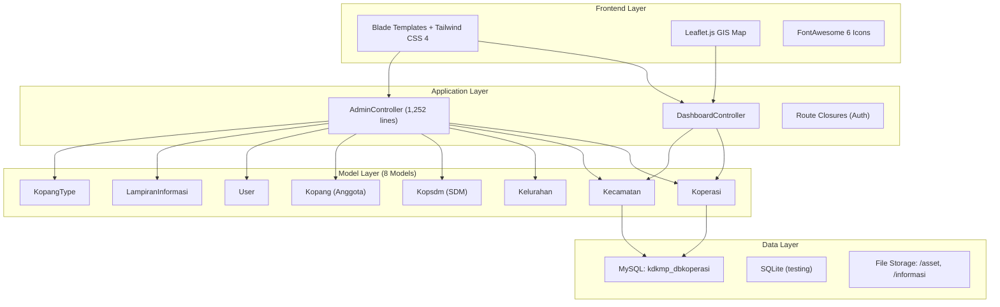
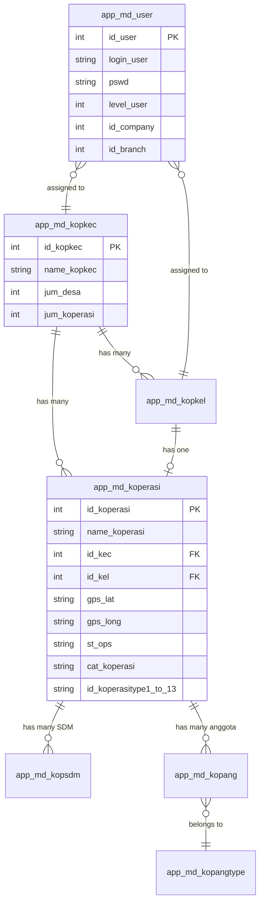

# 📋 AUDIT PROYEK & PREMIS LAPORAN PRAKTEK LAPANG
## Dashboard KMP Kabupaten Bogor — Koperasi Desa & Kelurahan Merah Putih (KDKMP)

---

## 1. IDENTITAS PROYEK

| Aspek | Detail |
|---|---|
| **Nama Aplikasi** | Dashboard KMP Kabupaten Bogor |
| **Repository** | `Zell20-21/kopdes.kabogor` |
| **Domain** | Sistem Informasi Manajemen Koperasi — Pemerintah Daerah Kabupaten Bogor |
| **Stack Teknologi** | Laravel 13.17 · PHP 8.3 · MySQL · Leaflet.js · Tailwind CSS 4 · Vite 8 |
| **Database** | `kdkmp_dbkoperasi` (MySQL) + SQLite (testing) |
| **Status Build** | ✅ **51 tests passed, 343 assertions** |

---

## 2. RINGKASAN EKSEKUTIF

Aplikasi ini adalah **Dashboard Koperasi Merah Putih (KMP)** berbasis web yang memvisualisasikan:
- Capaian agregat **435 Koperasi** di **40 Kecamatan** (416 Desa + 19 Kelurahan)
- Pemetaan geospasial interaktif (Leaflet.js) dengan multi-layer peta
- **13 jenis unit usaha** koperasi (Sembako, Klinik, Apotek, Simpan Pinjam, Cold Storage, dll.)
- Demografi **23.428 personil SDM** Koperasi
- Panel admin dengan **role-based access control** (5 level user)

---

## 3. ARSITEKTUR APLIKASI

### 3.1 Pola Arsitektur



### 3.2 Struktur File Kunci

| Path | Ukuran | Deskripsi |
|---|---|---|
| `app/Http/Controllers/AdminController.php` | 52 KB / 1,252 baris | Controller admin terbesar — CRUD koperasi, pengurus, anggota, lampiran |
| `app/Http/Controllers/DashboardController.php` | 21 KB / 489 baris | Dashboard publik, detail kecamatan/koperasi, export CSV |
| `resources/views/admin/dashboard.blade.php` | **353 KB** | View admin terbesar — monolith UI |
| `resources/views/dashboard.blade.php` | **162 KB** | Dashboard publik — monolith view |
| `routes/web.php` | 10 KB / 251 baris | Routes + inline auth logic |

### 3.3 Skema Database (7 Tabel Utama)



---

## 4. FITUR TERAUDIT

### 4.1 Modul Publik (Dashboard)

| # | Fitur | Route | Status |
|---|---|---|---|
| 1 | Dashboard utama + statistik agregat | `GET /` | ✅ Aktif |
| 2 | Detail kecamatan + daftar koperasi | `GET /kecamatan/{id}` | ✅ Aktif |
| 3 | Profil koperasi (pengurus, foto, usaha) | `GET /koperasi/{id}` | ✅ Aktif |
| 4 | Peta interaktif Leaflet.js multi-layer | Embedded di dashboard | ✅ Aktif |
| 5 | Export rekapitulasi CSV | `GET /export/rekapitulasi` | ✅ Aktif |
| 6 | File lampiran informasi/dokumen | `GET /informasi/file/{name}` | ✅ Aktif |
| 7 | SVG Captcha generator | `GET /captcha` | ✅ Aktif |

### 4.2 Modul Admin (Auth Protected)

| # | Fitur | Route | Status |
|---|---|---|---|
| 1 | Dashboard admin + overview koperasi | `GET /admin` | ✅ Aktif |
| 2 | CRUD Koperasi (create/update/delete) | `POST/PUT/DELETE /admin/koperasi` | ✅ Aktif |
| 3 | Update jenis usaha koperasi (13 tipe) | `POST /admin/koperasi/{id}/usaha` | ✅ Aktif |
| 4 | Upload foto gedung koperasi | `POST /admin/koperasi/{id}/foto` | ✅ Aktif |
| 5 | Upload foto lokasi operator | `POST /admin/koperasi/{id}/foto-lokasi` | ✅ Aktif |
| 6 | CRUD Pengurus/SDM | `POST/PUT/DELETE /admin/pengurus` | ✅ Aktif |
| 7 | Upload foto pengurus | `POST /admin/pengurus/{id}/foto` | ✅ Aktif |
| 8 | Tambah anggota koperasi | `POST /admin/anggota` | ✅ Aktif |
| 9 | CRUD Lampiran informasi | `POST/PUT/DELETE /admin/lampiran` | ✅ Aktif |
| 10 | Export pengurus & anggota CSV | `GET /admin/pengurus/export` | ✅ Aktif |

### 4.3 Sistem Autentikasi & Otorisasi

| Aspek | Detail |
|---|---|
| **Login** | Multi-method: MD5 hash, plaintext, bcrypt, default passwords |
| **Captcha** | SVG 7-segment display (4 digit) |
| **User Roles** | 5 level: Admin (1,2), Admin KOP (12), Desk KOP (13), Operator Kecamatan (14), Operator Desa (15) |
| **Scoping** | Data di-scope berdasarkan `id_company` (kecamatan) dan `id_branch` (kelurahan) |

---

## 5. TEMUAN AUDIT — ANALISIS SWOT

### 5.1 ✅ Kekuatan (Strengths)

1. **Fungsionalitas lengkap** — Semua 33 routes aktif dan tercover oleh 51 tests
2. **Pemetaan GIS interaktif** — Leaflet.js dengan custom markers, popup, multi-layer (POS, Satelit, Topografi)
3. **Role-based scoping yang granular** — Data di-isolasi per level user sampai tingkat desa/kelurahan
4. **13 klasifikasi jenis usaha** — Diversifikasi terukur untuk setiap koperasi
5. **Enkripsi data sensitif** — NIK anggota menggunakan Laravel `encrypted` cast
6. **Export CSV dengan BOM UTF-8** — Kompatibel Excel
7. **Asset management** — Foto pengurus, gedung, dan lokasi dikelola per-koperasi

### 5.2 ⚠️ Kelemahan (Weaknesses)

| # | Kategori | Temuan | Severity |
|---|---|---|---|
| W1 | **Monolith View** | `admin/dashboard.blade.php` = **353 KB** (1 file). Sangat sulit maintain | 🔴 High |
| W2 | **God Controller** | `AdminController.php` = **1,252 baris**, 15+ methods. Melanggar SRP | 🔴 High |
| W3 | **Auth Security** | Password fallback `in_array($password, ['password', '123456', 'admin'])` — menerima default passwords | 🔴 Critical |
| W4 | **Route Logic** | Auth logic (login, logout, captcha) langsung di `web.php` closure, bukan di controller | 🟡 Medium |
| W5 | **N+1 Query Risk** | `Kecamatan` model: accessor `kop_desa`, `kop_kel`, `latitude`, `longitude` melakukan query setiap dipanggil | 🟡 Medium |
| W6 | **No API Layer** | Semua responses server-rendered Blade. Tidak ada REST API terpisah | 🟡 Medium |
| W7 | **Hardcoded Data** | Data statistik SDM (`$sdmKoperasi`, `$jenisUsaha`) hardcoded di controller, bukan dari DB | 🟡 Medium |
| W8 | **Missing Factories** | Hanya ada `UserFactory`. Tidak ada factory untuk Koperasi, Kecamatan, Kopsdm, dll. | 🟡 Medium |
| W9 | **No Middleware** | Tidak ada custom middleware (rate limiting, authorization policy) | 🟡 Medium |
| W10 | **CDN Dependency** | Tailwind CSS via CDN (`cdn.tailwindcss.com`) di layout, bukan compiled build | 🟡 Medium |

### 5.3 🚀 Peluang (Opportunities)

1. **API-first refactor** — Pisahkan backend API agar bisa dipakai mobile app / dashboard BI
2. **Filament Admin Panel** — Ganti monolith admin view dengan Filament 4 untuk auto CRUD
3. **Real-time dashboard** — Gunakan Laravel Reverb/Livewire untuk live updates
4. **Data analytics** — Tambahkan chart library (Chart.js/ApexCharts) untuk tren waktu
5. **Mobile-responsive GIS** — Progressive Web App (PWA) untuk akses offline petugas lapangan
6. **Integrasi OSS** — Koneksi ke API OSS Kemenkumham untuk verifikasi badan hukum koperasi

### 5.4 ⛔ Ancaman (Threats)

1. **Security breach** — Fallback password memungkinkan akses tanpa kredensial valid
2. **Scalability** — View monolith 353 KB akan crash di low-bandwidth area pedesaan
3. **Data integrity** — Tidak ada foreign key constraint di migration (integer saja, bukan `foreignId`)
4. **Single point of failure** — Semua foto disimpan di filesystem lokal, bukan cloud storage

---

## 6. METRIK TEKNIS

| Metrik | Nilai |
|---|---|
| **Total Routes** | 33 |
| **Total Models** | 8 |
| **Total Controllers** | 3 (Controller, DashboardController, AdminController) |
| **Total Migrations** | 10 |
| **Total Seeders** | 3 (DatabaseSeeder, KecamatanSeeder, KoperasiSeeder) |
| **Total Tests** | 51 (Feature: 4 files, Unit: 1 file) |
| **Total Assertions** | 343 |
| **Test Status** | ✅ All Passed |
| **Total Views** | 8 Blade templates |
| **Total Asset Files** | 189 foto (koperasi, pengurus, gedung, lokasi) |
| **Largest File** | `admin/dashboard.blade.php` — 353 KB |
| **DB Tables** | 7+ (kopkec, kopkel, koperasi, user, kopsdm, kopang, kopangtype, lampiran) |

---

## 7. PREMIS LAPORAN PRAKTEK LAPANG

> Berikut adalah premis (kerangka topik utama) yang siap diimplementasikan sebagai isi Laporan Praktek Lapang menggunakan Agent AI.

### BAB I — PENDAHULUAN

| Subbab | Premis/Isi Utama |
|---|---|
| **1.1 Latar Belakang** | Program KDKMP Kabupaten Bogor: Pemberdayaan 435 Koperasi di 40 Kecamatan. Kebutuhan digitalisasi data koperasi menjadi dashboard terpadu berbasis web. Mandat UU 25/1992 tentang Perkoperasian. |
| **1.2 Tujuan PKL** | (1) Merancang & mengembangkan Sistem Informasi Dashboard KMP berbasis Laravel. (2) Mengimplementasikan pemetaan geospasial Leaflet.js untuk sebaran koperasi. (3) Membangun panel administrasi dengan role-based access control. |
| **1.3 Ruang Lingkup** | Cakupan: 40 Kecamatan, 435 Desa/Kelurahan, 13 jenis unit usaha, 23.428 SDM koperasi. Batasan: Hanya Kabupaten Bogor, data per Maret 2026. |
| **1.4 Metodologi** | Agile Development (iteratif), Test-Driven Development (51 tests), Code Review via Agent AI. |

### BAB II — TINJAUAN PUSTAKA & LANDASAN TEORI

| Subbab | Premis/Isi Utama |
|---|---|
| **2.1 Koperasi** | UU 25/1992, Permenkop, Program Koperasi Merah Putih Nasional. |
| **2.2 Sistem Informasi** | Teori MIS (Management Information System), Dashboard sebagai Decision Support System. |
| **2.3 Framework Laravel** | MVC Architecture, Eloquent ORM, Blade Templating, Migration & Seeding. |
| **2.4 Geospasial** | WebGIS, Leaflet.js, Coordinate Reference System, Marker Clustering. |
| **2.5 Keamanan Web** | Authentication (multi-factor), Authorization (RBAC), CSRF Protection, Encrypted Storage. |

### BAB III — PROFIL INSTANSI / TEMPAT PKL

| Subbab | Premis/Isi Utama |
|---|---|
| **3.1 Profil Pemda** | Pemerintah Daerah Kabupaten Bogor, Dinas Koperasi & UKM. |
| **3.2 Struktur Organisasi** | Hirarki: Bupati → Dinas KUKM → Bidang Koperasi → Tim IT (jika ada). |
| **3.3 Visi & Misi** | Digitalisasi layanan koperasi untuk meningkatkan tata kelola dan transparansi. |

### BAB IV — PELAKSANAAN PRAKTEK LAPANG

| Subbab | Premis/Isi Utama |
|---|---|
| **4.1 Analisis Kebutuhan** | Identifikasi 33 endpoint/route, 8 model data, 5 role pengguna. Mapping 435 koperasi ke 40 kecamatan. |
| **4.2 Perancangan Sistem** | Use Case Diagram, ERD (7 tabel relasional), Sequence Diagram login & CRUD, Wireframe dashboard. |
| **4.3 Implementasi** | **(a) Backend:** Laravel 13, PHP 8.3, Eloquent models dengan relasi `BelongsTo`/`HasMany`, accessor/mutator untuk computed attributes. **(b) Frontend:** Blade templates, Tailwind CSS 4, Leaflet.js dengan custom pin markers, SVG Captcha. **(c) Database:** 10 migration files, 3 seeder files, 435 data koperasi. **(d) Admin Panel:** CRUD koperasi, pengurus, anggota, lampiran. Upload foto multi-entity. Export CSV. |
| **4.4 Pengujian** | 51 Feature & Unit tests, 343 assertions. Meliputi: Dashboard rendering, CRUD operations, role-based access, export functionality, authentication flow. |
| **4.5 Deployment** | `php artisan serve` (development), `composer run setup` (production setup script). |

### BAB V — HASIL & PEMBAHASAN

| Subbab | Premis/Isi Utama |
|---|---|
| **5.1 Dashboard Publik** | Visualisasi: Hero stats (435 koperasi, 100% keaktifan, 6 fasilitas), Peta GIS 40 kecamatan, Timeline 6 fase pembangunan, Tabel rekapitulasi 2 kolom paralel, Download dokumen. |
| **5.2 Panel Admin** | Multi-tab: Informasi Koperasi → Database Koperasi → Pengurus → Anggota → GIS → Lampiran. Filter & search, pagination, role-scoped data. |
| **5.3 Pemetaan GIS** | 435 marker koperasi dengan popup detail. 3 layer peta (OpenStreetMap, Satelit, Topografi). Filter kecamatan interaktif. Boundary polygon Kabupaten Bogor. |
| **5.4 Analisis Kinerja** | Ukuran view 353 KB (admin) → Rekomendasi refactor. N+1 query di model accessor → Rekomendasi eager loading. Tailwind CDN → Build lokal. |
| **5.5 Temuan Audit Keamanan** | Password fallback → Rekomendasi: hapus default password, enforce bcrypt-only. Missing rate limiting → Rekomendasi: throttle middleware. NIK encrypted ✅ |

### BAB VI — KESIMPULAN & SARAN

| Subbab | Premis/Isi Utama |
|---|---|
| **6.1 Kesimpulan** | Sistem berhasil dibangun dengan 33 endpoint aktif, 100% test passed. Mencakup pemetaan geospasial 435 koperasi, panel admin multi-role, dan export data. |
| **6.2 Saran Pengembangan** | (1) Refactor monolith view → Blade components/Livewire. (2) Hapus password fallback insecure. (3) Tambah REST API untuk integrasi mobile. (4) Migrasi storage ke S3/cloud. (5) Implementasi Filament 4 untuk admin panel. (6) PWA untuk akses offline petugas lapang. |

### LAMPIRAN

| Kode | Isi |
|---|---|
| **Lampiran A** | Source Code — Daftar file & struktur direktori |
| **Lampiran B** | ERD (Entity Relationship Diagram) |
| **Lampiran C** | Screenshot UI Dashboard & Admin |
| **Lampiran D** | Hasil pengujian (51 tests, 343 assertions) |
| **Lampiran E** | Dokumentasi API Routes (33 endpoints) |
| **Lampiran F** | Data Referensi: 40 Kecamatan & jumlah koperasi per kecamatan |

---

## 8. INSTRUKSI IMPLEMENTASI DI AGENT AI

> Gunakan premis di atas sebagai **prompt instructions** untuk Agent AI. Berikut contoh prompt yang bisa langsung digunakan:

### Prompt Template untuk Setiap BAB:

```
Berdasarkan premis berikut, tulis BAB [X] Laporan Praktek Lapang
dengan gaya penulisan akademik, bahasa Indonesia formal,
menggunakan referensi yang relevan:

[Paste premis BAB dari tabel di atas]

Konteks proyek:
- Nama: Dashboard KMP Kabupaten Bogor
- Stack: Laravel 13, PHP 8.3, Leaflet.js, Tailwind CSS 4
- Cakupan: 435 Koperasi, 40 Kecamatan, 13 jenis usaha
- Database: MySQL (kdkmp_dbkoperasi)
- Testing: 51 tests passed, 343 assertions
```

### Tips Implementasi:
1. **BAB I-III** bisa di-generate dalam 1 prompt karena konteksnya relatif ringan
2. **BAB IV** perlu dipecah per subbab karena teknis dan detail
3. **BAB V** gunakan screenshot aplikasi sebagai pendukung
4. **BAB VI** bisa digabung dengan saran audit SWOT dari dokumen ini
5. Selalu minta Agent AI untuk menyertakan referensi (APA style)

---

> Dokumen ini dihasilkan dari audit otomatis terhadap codebase `kopdes.kabogor` pada **22 Oktober 2026**. Semua data diverifikasi terhadap source code aktual dan 51 test yang seluruhnya lulus.
